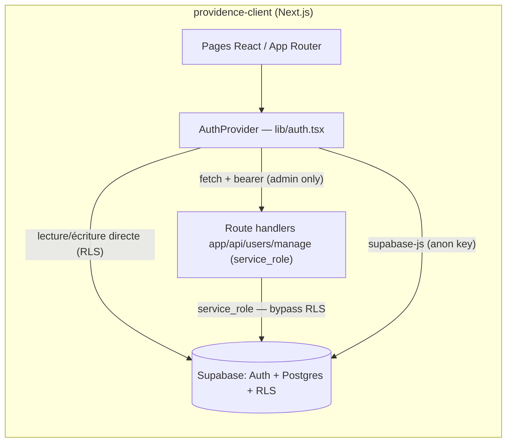
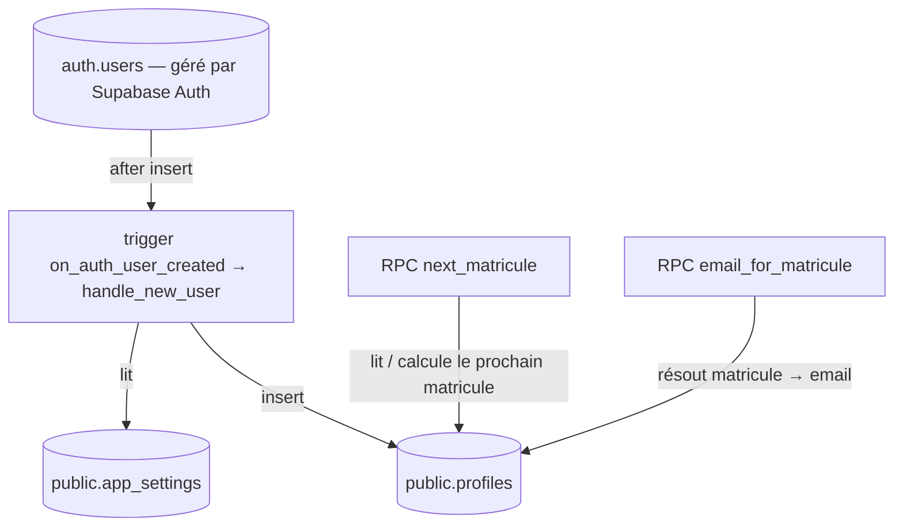
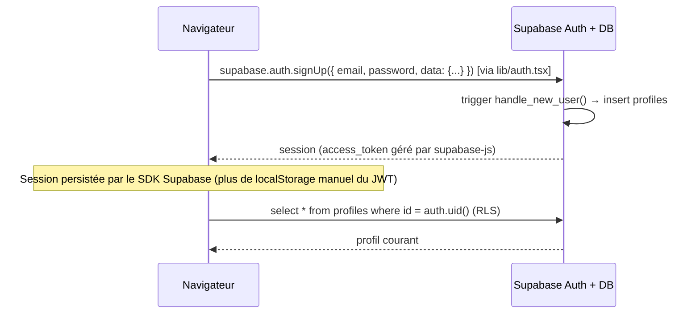

# teachMe — Architecture & préparation aux mises à jour

Ce document résume la **cartographie technique** du dépôt (utile pour
apprendre Next.js + Supabase) et une **checklist** avant une montée de
version majeure.

---

## 1. État vérifié (sanity check)

À date, les commandes suivantes doivent réussir :

| Projet               | Commande          | Rôle                      |
|----------------------|--------------------|---------------------------|
| `providence-client`  | `pnpm run build`   | Build production Next.js  |

**Structure logique :**

- Une seule application : le client **Next.js 14** (App Router).
- Données métier + comptes : **Supabase** (Postgres + Auth + Row Level
  Security). Il n'y a plus de serveur applicatif séparé — `providence-server`
  (NestJS/TypeORM) a été retiré.
- Auth : **Supabase Auth** (email + mot de passe). Les étudiants sans email
  reçoivent un email synthétique `matricule@student.local` à l'inscription.
- Quelques opérations administratives (créer un compte au nom d'un admin,
  changer le mot de passe/email d'un tiers, supprimer un compte) nécessitent
  la clé secrète `service_role` : elles passent par des **route handlers**
  Next.js (`app/api/users/manage/**`), jamais exécutées côté navigateur.

**Limites connues (à améliorer plus tard) :**

- Pas de confirmation d'email (désactivée dans le projet Supabase) : à
  reconsidérer si de vrais emails d'étudiants/staff doivent être vérifiés.
- Les policies RLS empêchent un utilisateur non-admin de changer son propre
  `role`/`user_type`/`matricule`/`email`, mais la validation fine des champs
  (ex. formats) reste minimale côté DB — à renforcer avec des `CHECK`
  supplémentaires si besoin.

---

## 2. Vue d'ensemble (du navigateur à la base)



**À retenir :** la majorité des opérations (login, register, lecture de son
profil, complétion de profil étudiant) passent **directement** du navigateur
vers Supabase via `supabase-js` (clé `anon`), protégées par les policies RLS.
Seules les opérations qui touchent `auth.users` au nom d'un tiers (création
par un admin, suppression, changement de mot de passe/email d'un autre
compte) transitent par une route serveur Next.js utilisant la clé
`service_role`.

---

## 3. Schéma Supabase (`supabase/migrations/0001_init.sql`)



**Tables et fonctions clés :**

| Rôle | Nom |
|------|-----|
| Profil utilisateur (1:1 avec `auth.users`) | `public.profiles` |
| Réglages bootstrap (superuser/admin par email) | `public.app_settings` |
| Création automatique du profil à l'inscription | trigger `on_auth_user_created` → fonction `handle_new_user()` |
| Génération du matricule étudiant | RPC `next_matricule(location)` |
| Résolution matricule → email (login par matricule) | RPC `email_for_matricule(matricule)` |
| Protection des colonnes sensibles en update | trigger `trg_protect_privileged_profile_columns` |

Pour configurer les rôles bootstrap (remplace les anciennes env vars
`BOOTSTRAP_SUPERUSER_EMAIL` / `BOOTSTRAP_ADMIN_EMAILS`) :

```sql
update public.app_settings set value = 'moi@providence.academy'
  where key = 'bootstrap_superuser_email';

update public.app_settings set value = 'admin1@ecole.com,admin2@ecole.com'
  where key = 'bootstrap_admin_emails';
```

---

## 4. Flux d'authentification (simplifié)



Le login par matricule résout d'abord l'email associé via la RPC
`email_for_matricule`, puis appelle `supabase.auth.signInWithPassword`.

---

## 5. Côté client Next

```mermaid
flowchart TB
  L[layout.tsx] --> P[Providers]
  P --> AUTHP[AuthProvider lib/auth.tsx]
  AUTHP --> SBC[lib/supabase/client.ts — clé anon]
  AUTHP -->|"opérations admin"| APIROUTE[app/api/users/manage — clé service_role]

  subgraph pages["Pages"]
    A[/auth]
    R[/register]
    D[/dashboard/*]
  end

  pages --> AUTHP
```

- **`lib/supabase/client.ts`** : client navigateur (clé `anon`), utilisé par
  `lib/auth.tsx` pour toutes les opérations en lecture/écriture directe.
- **`lib/supabase/admin.ts`** : client `service_role`, **serveur uniquement**
  (`import 'server-only'`), utilisé dans `app/api/users/manage/**/route.ts`.
- **`lib/auth.tsx`** : état React, expose `useAuth()` (login, register,
  logout, CRUD admin des utilisateurs) — même contrat qu'avant, implémentation
  Supabase en dessous.

---

## 6. Mini-guide — préparer une montée de version

### 6.1 Ordre recommandé

1. **Lire le changelog officiel** de la cible (Next.js, `@supabase/supabase-js`).
2. **Branches Git** : une branche dédiée `chore/upgrade-…`.
3. **Montée par étapes** : dépendances → build + lint → tests manuels
   (login, register, admin, onboarding étudiant).

### 6.2 Next.js (ex. 14 → 15+)

- Lire : [Next.js upgrade guides](https://nextjs.org/docs/app/building-your-application/upgrading).
- Points sensibles : App Router, route handlers (`app/api/**/route.ts`),
  `next.config.js`.

### 6.3 Supabase

- Suivre le changelog de [`@supabase/supabase-js`](https://github.com/supabase/supabase-js/releases).
- Vérifier après upgrade : `supabase.auth.signUp/signInWithPassword`,
  `auth.admin.createUser/updateUserById/deleteUser`, `supabase.rpc(...)`.
- Toute modification du schéma (`supabase/migrations/`) doit être appliquée
  manuellement dans le SQL Editor du dashboard (pas de CLI Supabase branchée
  ici pour l'instant).

### 6.4 Variables d'environnement

Après upgrade, revalider (`providence-client/.env.local`) :

- `NEXT_PUBLIC_SUPABASE_URL`, `NEXT_PUBLIC_SUPABASE_ANON_KEY`
- `SUPABASE_SERVICE_ROLE_KEY` (secret — ne jamais committer, ne jamais
  préfixer `NEXT_PUBLIC_`)

### 6.5 Checklist rapide

- [ ] `pnpm run build` (client)
- [ ] `pnpm run lint` (client)
- [ ] Connexion `superuser@providence.academy` (via `scripts/seed-demo-users.mjs`)
- [ ] Création utilisateur (staff + étudiant) depuis le dashboard admin
- [ ] Login par matricule
- [ ] Onboarding étudiant (`completeStudentProfile`)

---

## 7. Pour aller plus loin

- **Row Level Security (RLS)** : chaque table sensible doit avoir ses
  policies explicites (`select`/`update`) — voir `supabase/migrations/0001_init.sql`.
- **`security definer`** : utilisé pour les fonctions qui doivent lire/écrire
  au-delà de ce que l'appelant est autorisé à voir directement (bootstrap de
  rôle, résolution matricule → email), en gardant une surface d'accès
  minimale (une fonction = un besoin précis).
- **Route handlers Next.js** (`app/api/**/route.ts`) : équivalent des anciens
  contrôleurs NestJS, mais réservés aux seules opérations qui exigent la clé
  `service_role`.

---

*Document généré pour le dépôt PROVIDENCE — plateforme teachMe.*
